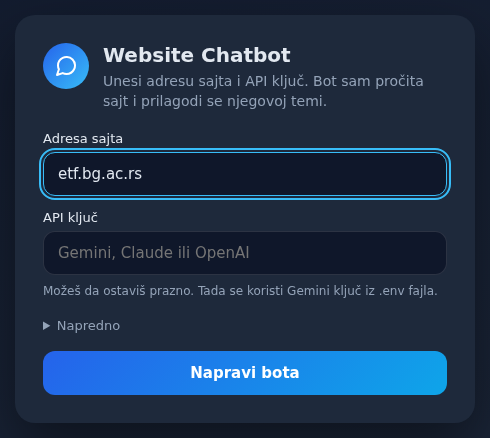
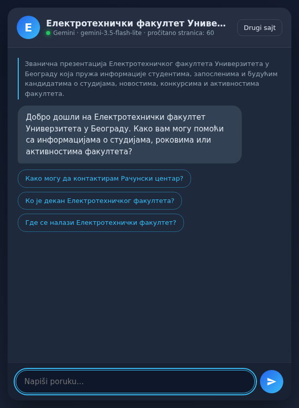
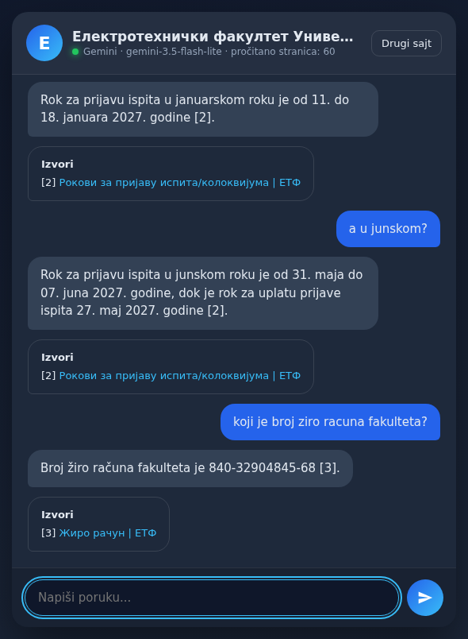
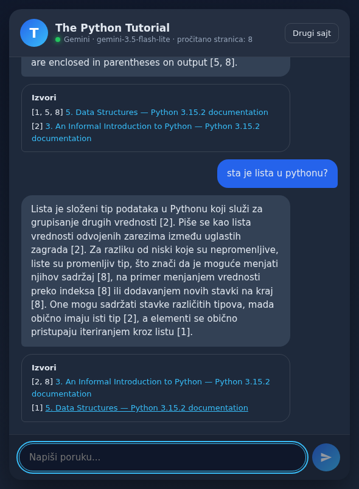
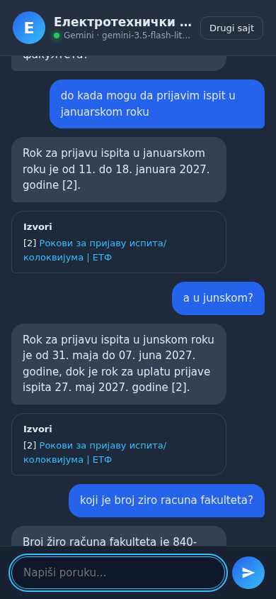

# Website Chatbot

Paste a website address and an API key to get a chatbot for that site. It reads the site, works out what the site is about, adapts its name, greeting and suggested questions, and answers from the site's pages with links to its sources.

<p>
  
</p>

| Adapts to the site | Answers with sources | Answers across languages |
|---|---|---|
|  |  |  |

The layout also works on a phone:



## Run it

Requires Node.js 20 or newer.

```bash
npm install
npm start
```

Open http://localhost:3000, enter a website, paste an API key, and click **Napravi bota**.

The first run downloads a local search model of about 130 MB. After that, a site of 60 pages takes about a minute to load.

To avoid pasting a key each time, copy `.env.example` to `.env` and add it there. The bot only reads keys from the page and from this file, never from your shell, so it can't spend from an account you didn't choose.

## Models

The provider is detected from the key. Under **Napredno** you can choose the provider, the model, and how many pages to read.

| Provider | Key starts with | Default model |
|---|---|---|
| Gemini | `AIza` | `gemini-3.5-flash-lite` |
| Claude | `sk-ant-` | `claude-opus-5-5` |
| OpenAI | `sk-` | `gpt-5.5` |

## How it works

```
                                  ┌─ BM25 (exact words and codes) ─┐
URL ─ read pages ─ split ─ index ─┤                                ├─ merge ─ top 8 passages ─ model ─ answer + sources
       │                          └─ local embeddings (meaning) ───┘
       └─ model studies the site ─ name, tone, greeting, suggested questions
```

1. **Read.** The crawler starts from your URL and stays on that site. It follows menu links first, because they lead to lasting content while links in the page body are often news. It respects `robots.txt`.
2. **Adapt.** The model reads excerpts once and describes the site. That description shapes the greeting, the suggested questions and the tone of the answers.
3. **Search.** Each question runs through two searches, and the results are merged with Reciprocal Rank Fusion. The top 3 from each search always stay in, so one strong match can't get buried.
4. **Answer.** The model answers only from the passages, and says so when the site doesn't have the answer. Only pages the answer actually cites are shown as sources.

Three details are there for Serbian. Search treats Cyrillic and Latin as the same text, ignores diacritics, and cuts long words to their start so that "januarskom" finds "јануара". Replies use the alphabet of the question.

## Search quality

Measured on the [ETF website](https://www.etf.bg.ac.rs/), which is in Serbian Cyrillic, with questions I wrote after reading its pages. A question counts as found when one of the 8 returned passages has the answer.

| Method | 60 pages read live (25 questions) | 298 saved pages (33 questions) |
|---|---|---|
| Keywords only (BM25) | 17 | 20 |
| Embeddings only | 13 | 22 |
| Plain hybrid (RRF) | 17 | 25 |
| **This project's hybrid** | **21** | **26** |

The last row is the setup I chose after trying several on these same questions, so treat it as a rough guide, not a benchmark. On exact terms such as course codes and account numbers, across both sets, hybrid search found 15 of 15 and embeddings alone found 10 of 15.

## Limits

- It can't read sites that load their content with JavaScript, and it says so when it finds too little text.
- It skips PDFs and other files, so answers found only in those are missed.
- It reads 60 pages by default and up to 300, and indexes up to 1,500 passages. On a larger site, raise the page limit under **Napredno**.
- Questions in a different language from the site are weaker. For example, "where can I find tuition fees" misses the Serbian price list.
- Loaded sites are kept in memory, so restarting the server means reading them again.
- Free Gemini keys have low limits. `gemini-3.6-flash` allowed 20 requests per day during testing. When a limit is reached, the page shows a message and you can pick another model.
- It's built to run on your own machine and only accepts local connections. It isn't ready to be hosted as a public service.
- Real answers were tested with Gemini only. Claude and OpenAI were checked against a local fake server, and their real APIs were only used to confirm that an invalid key gets a clear error.

## Tests

```bash
npm test
```

The tests run without an API key or any cost. The provider tests run the real SDKs against a local fake server.
